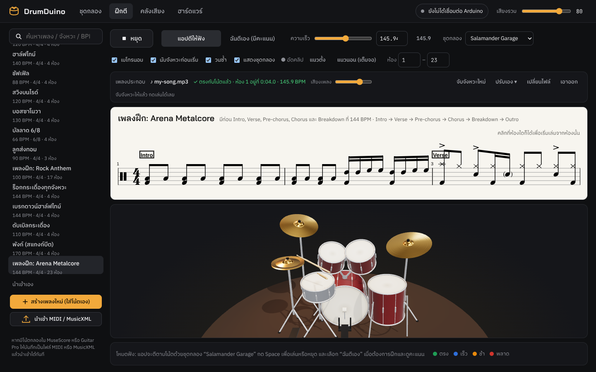
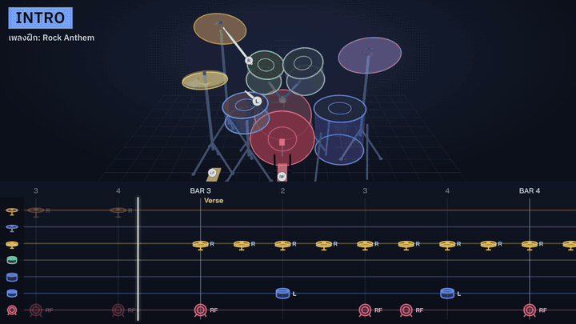
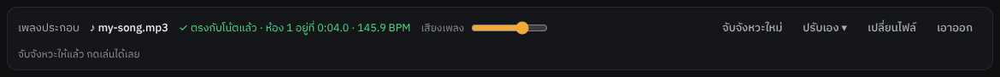
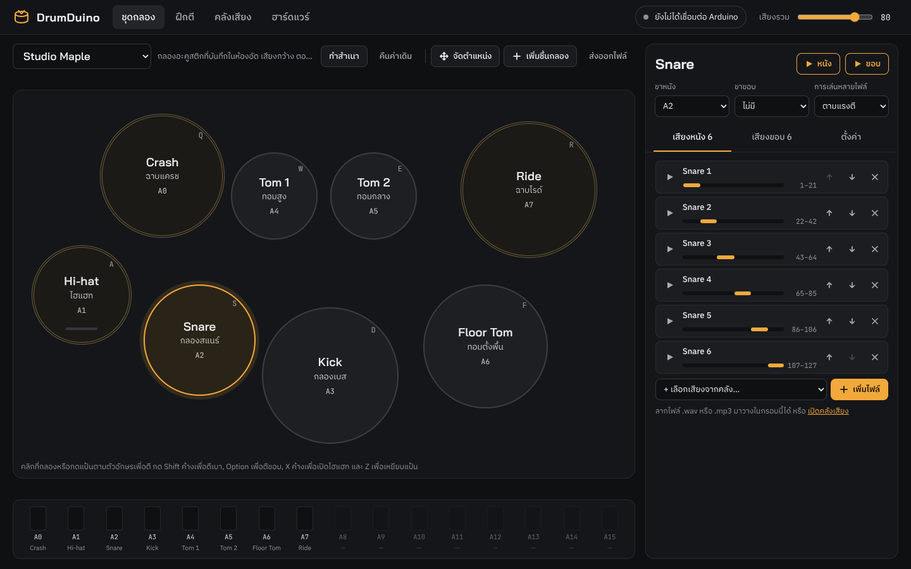
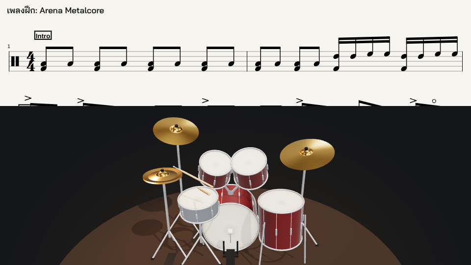
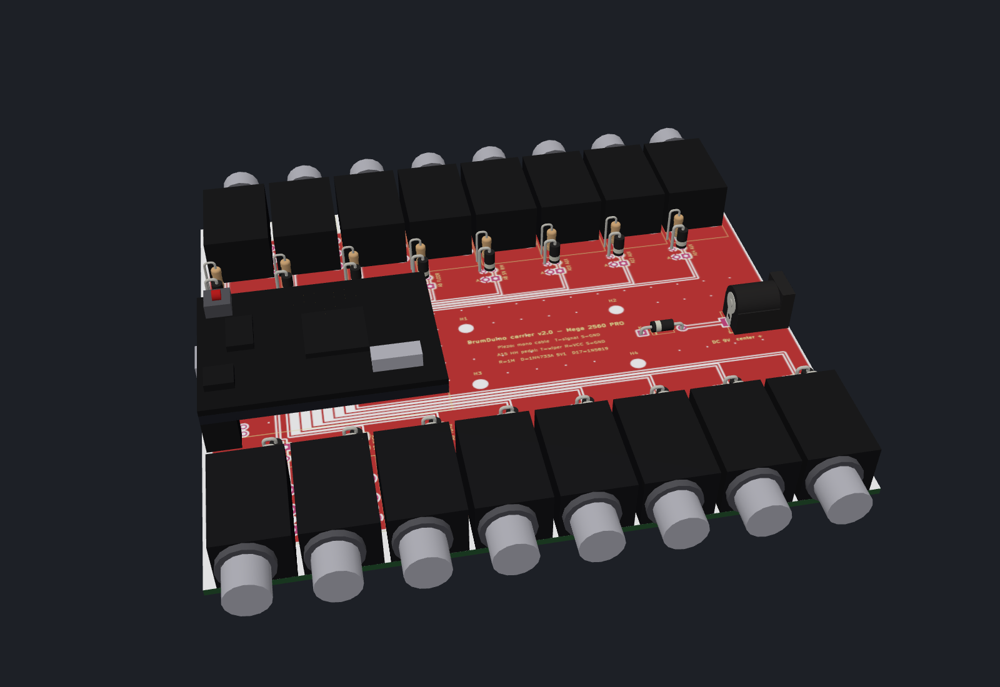
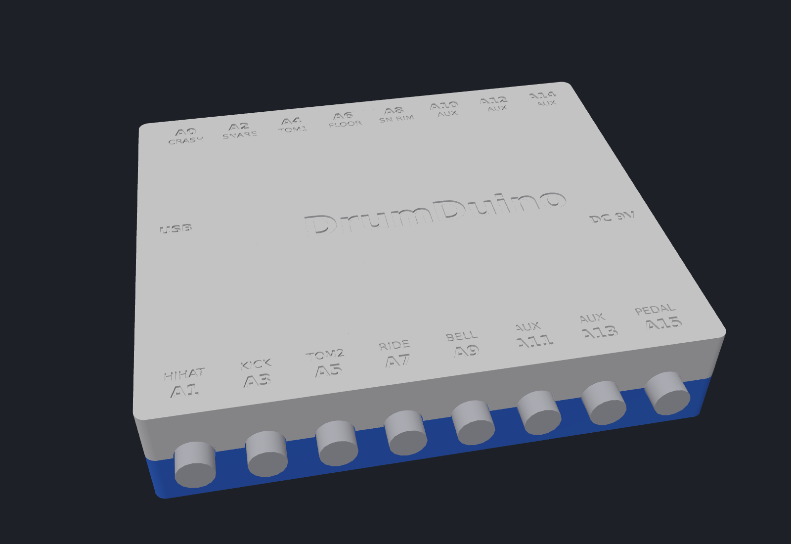

# DrumDuino

**English** · [ภาษาไทย](README.th.md)

An electronic drum app for macOS and Windows that works with an Arduino and piezo sensors.
Hit a pad and hear a real drum sample, practice along with the score and the original song, and record clips for social media, all in one app.
The app speaks Thai and English (switch with **ไทย | EN** in the top right).



## Features

**Drum sounds**
- 6 kits to choose from: Studio Maple, Black Pearl, Red Zeppelin, Arena Metal, Salamander Garage (real acoustic drums with several velocity layers) and Synth Kit
- Duplicate a kit into "My kit" and change its sounds; 3-band EQ (low / mid / high) per piece
- **Use your own samples, several per piece**: .wav .mp3 .ogg .flac .aiff (drag and drop), played by velocity layer · round robin · random
- Volume, pitch, sensor sensitivity and scan / mask time per piece, sent to the board automatically
- **Dual-zone pads**: head piezo + rim piezo with separate rim sounds (rimshot, ride bell, tom rim)
- **Hi-hat pedal**: closed / half-open / open by pedal depth, pedal "chick", open hi-hat chokes when the pedal closes, MIDI CC4 supported

**Practice**
- Standard 5-line drum notation with a moving cursor; click any bar to start from there
- **App plays** and **I play (scored)** modes (shows how many ms early / late, with a score) · metronome · count-in · BPM control · loop a range of bars · change kit right on the page
- **Lanes tab**: notes scroll toward you in colored lanes per piece, every note marked with its hand L / R or foot RF / LF, with a neon kit
- **3D drum kit**: the sticks move like real hands, lifting ahead of the next note and striking exactly on the beat. Hands alternate like a drummer (rolls and fills go R L R L), cymbals wobble, the kick beater swings. Click a drum to hit it, drag to orbit the view
- **Backing track + Auto Sync**: add the real song and the app works out which second bar 1 starts at and the song's actual BPM, then keeps the song in time with the score all the way through. Slowing down keeps the pitch
- Built-in grooves (rock, pop, funk, disco, shuffle, swing, bossa, 6/8, fills, practice songs with sections) and MIDI / MusicXML import (exports from MuseScore work)

<p align="center"></p>

**Recording**
- **Recording mode** in portrait or 16:9 landscape hides all menus, leaving only the notes and the 3D kit
- A script sets up OBS completely: camera + app window + the app's audio captured directly

**Hardware**
- Input over USB Serial (any board) or USB MIDI (Leonardo / Pro Micro); Arduino Mega gives 16 channels (A0–A15)
- PCB design for the Mega 2560 PRO with 16 × 6.35 mm jacks, plus a 3D-printed case
- No Arduino? Test with the keyboard, or **use an iPhone / iPad as wireless pads**: turn on *Play from iPhone / iPad* in the Hardware tab and scan the QR code. Taps play through the Mac over Wi-Fi (realistic kit with double kick, multi-touch, harder in the middle of a pad, hold-to-open hi-hat). Press Play and a ring in the drum's colour closes in on the pad you need to hit next, with the hand (L / R / RF / LF)
- Everything saves automatically; sample files stay on your computer

## Examples

### Example 1: practice along with a real song using Auto Sync

1. Open the **Practice** tab and pick a song from the list on the left
2. In the **Backing track** strip, press **♪ Choose audio file…** and pick the song's mp3 / m4a / wav
3. Wait 3–5 seconds: the app syncs it by itself and shows ✓ Synced
4. Press **Space** to play. The song plays its intro first, and the notes start moving exactly at bar 1



This screenshot uses a test track rendered from the "เพลงฝึก: Arena Metalcore" score (written at 144 BPM),
with a 4-second intro before the drums and played slightly faster than the score, at 146 BPM.
The app found bar 1 at **0:04.0** and the tempo at **145.9 BPM**, and set the playback speed to match.

| To do this | Do this |
|---|---|
| Practice slower | Move the speed slider: the song slows down too, without changing pitch |
| Drill one section | Enter the start–end bars and tick **Loop**: the song jumps along with it |
| Hear only the song and play yourself | Choose **I play (scored)**: the app's drums go quiet and you get a score |
| Song still slightly off | Press **Adjust** and use −/+ (song ahead of the drums → −, song behind → +) |

Auto Sync works best on studio recordings at a steady tempo where the score matches the recording's version.
If the song speeds up or slows down partway, or the score has a different number of bars than the song, it drifts from that point on.

### Example 2: import a score from MuseScore

1. In MuseScore, open the drum score and choose *File → Export → MIDI* (or MusicXML)
2. In the app press **Import MIDI / MusicXML** and pick the file

For many songs, press **Open folder** and put the files in the `my-scores` folder; the app loads them every time it starts.

```
my-scores/
├── song 1.mid
├── song 2.musicxml
└── ...
```

During development this folder is `./my-scores` in the project (gitignored, so personal scores never reach git).
In the installed app it lives in the app's data folder.
Section names (Markers) in a MIDI file appear as section labels on the score, and you can jump to them.

### Example 3: add your own snare with 6 velocity layers



1. In the **Kit** tab press **Duplicate** to make your own kit
2. Click **Snare** and drag `snare_01.wav` … `snare_06.wav` (soft to loud) into the box on the right
3. Set **Multiple files → By velocity**: the app splits the velocity range for you (1–21, 22–42, … 107–127)
4. In **Settings**, adjust volume, pitch and the low/mid/high EQ

### Example 4: record a drum clip with OBS



```bash
# Close OBS first, then run once (macOS)
python3 obs/setup_obs.py
open -a OBS --args --collection DrumDuino --profile DrumDuino
```

The script creates a **DrumDuino** scene collection (1920×1080, 60 fps, clips saved to `~/Movies/DrumDuino`).

| OBS scene | Use with recording mode | In the frame |
|---|---|---|
| ตีกลอง: กล้อง + แอป | Portrait | Camera on the left, notes and kit on the right |
| กล้องเต็มจอ | Any | Camera only |
| แอปเต็มจอ (แนวนอน) | Landscape | Notes and 3D kit fill the frame |
| แอปเต็มจอ + กล้องมุมเล็ก | Landscape | The same, with a small camera in the bottom-right corner |

In the app's Practice tab, press **● Record → Portrait** or **Landscape (full)**. The window shrinks and moves to exactly where OBS captures it (don't drag the window).
Space plays / stops, Esc leaves recording mode.
Drums and the backing track are recorded straight from the app, delayed 100 ms to line up with the camera. A microphone source is included but muted.

### Example 5: try it without an Arduino

Open the app and use the keyboard as drum pads.

| Key | Drum | | Key | Drum |
|---|---|---|---|---|
| Q | Crash | | A | Hi-hat |
| W | Tom 1 | | S | Snare |
| E | Tom 2 | | D | Kick |
| R | Ride | | F | Floor Tom |

Hold Shift = soft hit · Option/Alt = rim · hold X = open hi-hat · Z = hi-hat pedal

## Hardware

| Board | Channels | Connection |
|---|---|---|
| Arduino Nano | 8 (A0–A7) | USB Serial |
| Arduino Uno | 6 (A0–A5) | USB Serial |
| Arduino Mega | 16 (A0–A15) | USB Serial |
| Leonardo / Pro Micro | 8 | USB Serial + USB MIDI |

Wiring per channel: piezo (+) → analog pin, piezo (−) → GND, a 1 MΩ resistor across the analog pin and GND.
Recommended: a 5.1 V Zener diode across them for overvoltage protection.

Firmware: open `firmware/DrumDuino/DrumDuino.ino` in the Arduino IDE → pick the board/port → Upload
(Leonardo / Pro Micro need the `MIDIUSB` library installed first).

Default pins: A0 Crash · A1 Hi-hat · A2 Snare · A3 Kick · A4 Tom 1 · A5 Tom 2 · A6 Floor Tom · A7 Ride

### PCB and case (Mega 2560 PRO)

 

- **140 × 120 mm PCB:** 16 × 6.35 mm jacks, each channel protected (1 MΩ + 5.1 V Zener), a hi-hat pedal channel and a DC power jack.
  KiCad files, Gerbers for JLCPCB and the BOM are in [`hardware/drumduino-carrier/`](hardware/drumduino-carrier/README.md)
- **3D-printed case:** separate base and lid held by 4 × M3 × 25 mm screws. STL files are in [`hardware/enclosure/`](hardware/enclosure/README.md)

Example pad hookup: piezo cable → mono 1/4" plug → jack A2 on the case → shows up as Snare in the app right away.

## Development

Requires [Node.js](https://nodejs.org) 20 or newer.

```bash
npm install
npm run dev        # run the app with hot reload
```

## Building installers

```bash
npm run dist:mac   # must run on a Mac     → release/DrumDuino-x.y.z-arm64.dmg and -x64.dmg
npm run dist:win   # must run on Windows   → release/DrumDuino Setup x.y.z.exe
```

### Let GitHub build both (no Mac/Windows machine needed)

The workflow is already in `.github/workflows/build.yml`.

1. Push this project to GitHub
2. Tag a version and push it: `git tag v0.1.0 && git push --tags`
3. After about 10 minutes the `.dmg` and `.exe` files appear on the **Releases** page
   (or press Run workflow in the Actions tab and download from Artifacts)

### Installing notes

The installers aren't signed with an Apple/Microsoft certificate yet, so the first launch shows a warning:

- **macOS**: drag the app to Applications, then right-click it → Open → Open.
  If it says the app is "damaged", run in Terminal: `xattr -cr /Applications/DrumDuino.app`
- **Windows**: if SmartScreen appears, click *More info* → *Run anyway*

To distribute to the public, get an Apple Developer ID ($99/year) and a Windows code-signing certificate and configure them in electron-builder.

## Serial protocol (115200 baud)

Real messages after plugging in the board, then hitting the snare, the snare rim, and pressing the hi-hat pedal halfway:

```
← I DRUMDUINO 1.2 16        board introduces itself: firmware 1.2, 16 channels
→ T 2 40                    app sets the threshold of A2 (Snare) = 40
← H 2 96                    snare head hit, velocity 96
← H 2 110 R                 snare rim hit, velocity 110
← C 15 512                  hi-hat pedal (A15) mid-travel ≈ half-open (depends on pedal calibration)
```

All messages:

```
board → app   I DRUMDUINO <version> <channels>
              H <channel> <velocity 1–127> [R]     R = rim
              C <channel> <raw 0–1023>             hi-hat pedal position
app → board   E <channel> <0|1>                    enable / disable a pin
              T <channel> <threshold 0–1023>
              S <channel> <scan ms>
              M <channel> <mask ms>
              P <head channel> <rim channel|-1>    pair a rim pin with a head pin
              X <head channel> <ratio %>           rim hit when rim ≥ head × ratio/100
              K <channel> <0|1>                    1 = this pin is a pedal (continuous sensor)
              ?
```

## Project layout

```
electron/        main process (window, Serial/MIDI permissions, port picker, recording mode)
src/audio/       audio engine, built-in kits, backing track + Auto Sync (backing.ts, align.ts)
src/input/       Serial, MIDI, keyboard
src/score/       notation (VexFlow), score player, MIDI/MusicXML import, 3D kit, lane view, sticking
src/pages/       Kit / Practice / Lanes / Sounds / Hardware pages
src/i18n/        Thai / English UI text
firmware/        Arduino code
hardware/        PCB (KiCad) and 3D-printed case
obs/             OBS setup script for recording
docs/images/     README images
```

## Sound credits

- **Studio Maple**: [Virtuosity Drums](https://versilian-studios.com/virtuosity-drums/) by Versilian Studios, CC0 license.
  Mixed from the kick + snare + overhead mics with a selection of velocity layers (`public/samples/LICENSE-VirtuosityDrums-CC0.txt`)
- **Black Pearl / Red Zeppelin**: [AVL Drumkits](https://github.com/studiorack/avl-drumkits) by Glen MacArthur ([bandshed.net](http://www.bandshed.net/avldrumkits/)),
  [CC BY-SA 3.0](https://creativecommons.org/licenses/by-sa/3.0/). Converted to stereo OGG, silent tails trimmed, panned as in the original SFZ files.
  These samples (including the modified ones) are redistributed under the same CC BY-SA 3.0 (`public/samples/avl/LICENSE-AVL-Drumkits-CC-BY-SA-3.0.txt`)
- **Salamander Garage**: [Salamander Drumkit](https://github.com/studiorack/salamander-drumkit) by Alexander Holm (Rytmenpinne),
  [CC BY-SA 3.0](https://creativecommons.org/licenses/by-sa/3.0/). 3–8 velocity layers chosen per piece, converted to OGG, shortened and level-matched by velocity.
  The modified files are redistributed under the same CC BY-SA 3.0 (`public/samples/sal/LICENSE-Salamander-Drumkit-CC-BY-SA-3.0.txt`)
- **Synth Kit**: generated in the app
